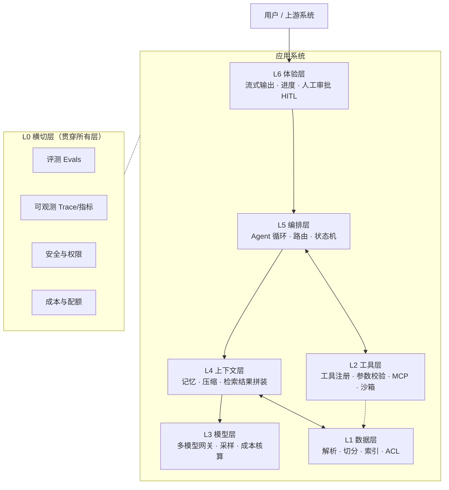

# 全景图：任何一个 AI 应用，都能拆成这七层

> 这是整个知识库的骨架。**看任何项目、写任何设计、答任何系统设计题，都先套这张图。**
> 用途三个：①读别人代码时定位它在哪一层 ②画白板时不漏层 ③线上出问题时判断"该查哪层"。

## 1. 一张图



**读法**：请求从上往下走，工具调用在 L5↔L2 之间来回（这是 Agent 和普通 API 最大的结构差别），L4 与 L1 双向（检索是独立的一跳）。L0 不参与数据流，但**每一层都要往上抛指标**。

## 2. 七层职责表（背下来）

| 层 | 一句话职责 | 关键产物 | 最常见的故障 | 对应坑 |
|---|---|---|---|---|
| **L6 体验** | 让 30 秒的等待可忍受、让不可逆操作可控 | 流式事件协议、进度、审批卡 | 工具参数被当正文吐出来；断线后状态丢失 | P9 |
| **L5 编排** | 决定"下一步做什么"，并保证一定会停 | 循环/状态机、步数与预算守卫、重试策略 | 死循环、跑飞、预算失控 | P4/P13 |
| **L4 上下文** | 在有限窗口里，把决策所需的证据放对位置 | 上下文装配器、压缩器、记忆读写 | 压缩后丢引用/丢约束、关键指令被淹 | P3/P11 |
| **L3 模型** | 屏蔽供应商差异，把成本和延迟算清 | Provider 接口、路由、价格表 | 换模型行为漂移、token 成本失控 | P16 |
| **L2 工具** | 把"模型想做的事"翻译成"系统能安全做的事" | 工具 schema、校验器、执行器、MCP server | 参数非法/幻觉、工具结果注入、越权 | P1/P2/P14 |
| **L1 数据** | 把非结构化世界变成可检索、可鉴权的块 | 解析器、切分器、索引、ACL | 解析丢表格、切分断语义、权限后过滤滤空 | P6/P7/P8 |
| **L0 横切** | 让"好不好"可量化、让"坏在哪"可定位 | 评测集、trace、配额 | 没有基线、没有 trace、评测不可复现 | P12/P15 |

## 3. 层间的"接口"是什么（面试最容易被追问的点）

| 接口 | 传什么 | 设计要点 |
|---|---|---|
| L6 → L5 | 用户输入 + 会话 id + 幂等键 | **前端必须传幂等键**，否则重试会重复下单 |
| L5 → L3 | `Message[]` + `ToolSpec[]` | 上下文层的产物要能被 token 预算裁剪 |
| L5 → L2 | `{toolName, args(JSON), ctx}` | args 一律当**不可信输入**，服务端二次校验 |
| L2 → L5 | `ToolResult{ok, content, errorKind}` | 错误要**结构化且可读**，模型才能改计划 |
| L4 → L1 | query + 过滤条件（含 tenant/ACL） | **过滤必须下推**到检索，不能先取后滤 |
| 全层 → L0 | span + usage + 结果标签 | 没有 span 的调用等于黑盒 |

> 一句自测：**随便挑两层，说出它们之间的数据结构和失败方式。**说不出来 = 没理解这个系统。

## 4. 怎么用它读代码（5 分钟定位法）

1. 找到入口（HTTP/CLI/前端事件）→ 这就是 L6→L5 的边界。
2. 找"调模型的那一处" → 它上面是 L4（拼上下文），下面是 L3（网关）。
3. 找"工具表/注册处" → L2 的边界；工具里凡是访问外部系统的，都是"权限与副作用"的责任点。
4. 找"检索函数" → L1/L4 的接缝；看过滤条件是在检索里还是检索后。
5. **找不到评测和 trace？** 那这个项目大概率是 demo——面试时可以直接问"你们怎么知道它变差了"。

## 5. 怎么用它画白板（8 分钟版）

```
① 先画用户 → 接入（这一层常被忘记：鉴权、限流、幂等）
② 画编排（方框写清：循环 or 工作流；停止条件是什么）
③ 画模型（写清：主模型 + 备用模型 + 路由规则）
④ 画工具（3-5 个框，每个写"读写"和"是否可逆"）
⑤ 画数据（库/索引/向量库，写清 ACL 在哪一层生效）
⑥ 底下横贯一条 L0（评测 + trace + 成本）
⑦ 最后补三段文字：关键指标、失败兜底、上线灰度
```
第 ⑦ 步是白板题的分水岭——大部分人画完架构就停了。

## 6. 常见"漏层"及其代价（真实项目里踩过的）

| 漏了哪层 | 上线后会怎样 |
|---|---|
| 漏 L6 的幂等 | 用户点了两次 / 网络重试 → 重复下单、重复退款（P15） |
| 漏 L5 的停止条件 | 一个格式异常触发无限工具调用，一夜烧掉 $1800（P4） |
| 漏 L4 的压缩策略 | 第 12 轮开始"忘记"前面的约束，答非所问（P3） |
| 漏 L2 的校验 | 模型编造订单号，直接打到生产库（P2） |
| 漏 L1 的 ACL 下推 | 先取 top-k 再过滤 → 有权限的文档全被滤空（P7） |
| 漏 L0 的评测 | 换个模型/改个 prompt 后"感觉变好了"，一周后客诉翻倍（P12） |

## 7. 与代码骨架的对应

七层不是概念，`projects/_template/` 里每一层都有落地文件，见 [03-框架/03-统一项目骨架](03-框架/03-统一项目骨架.md)。

**练习**：打开 `projects/_template/src/`，把每个文件标上它属于哪一层。标不出来的文件，说明你的分层还没想清。
