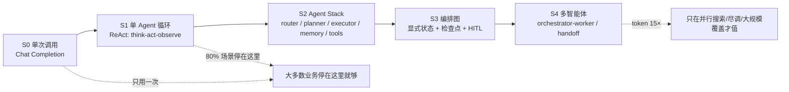

# Agent 架构演进：从一次调用到多智能体，以及被考察的深水区

> 一句话：**架构演进的每一步，都是在回答"上下文不够用了怎么办"**。
> 从"一次调用"到"多个 agent 并行"，中间隔的不是技术升级，而是四次**为上下文扩容**的尝试——每一步都带来了新的失效面。
>
> 读这篇要带的问题：**我现在这个系统在第几层？为什么不能停在上一层？**

---

## 0. 一张图

**方向不是"越高越好"**，是"越往下越贵"。选型的正确姿势是：**从 S1 开始，用评测证明单循环不够，再往上升一级**。

---

## 1. 五个阶段：每层为什么出现、在哪失效

### S0 单次调用（无循环）

- **形状**：一次请求 → 一次回答。没有工具、没有状态、错了不能重来。
- **够用的场景**：摘要、分类、改写、抽取、代码解释。
- **失效点**：不能落地到实时数据（"我们今天的退款政策是什么"只能靠训练语料）、不能自检、不能纠错。
- **判断标准**：**一次组织好的上下文能不能给出答案？** 能，就别做 Agent。

### S1 单 Agent 工具循环（ReAct 及其变体）

- **形状**：`think → act(tool) → observe → 循环`，直到**终止条件**（goal gate）成立。
- **为什么出现**：真实任务需要外部信息（查库、搜网页、调 API）和外部验证（算一遍、跑一次），一次调用做不到。
- **关键机制**（四个都必须有，缺一个就出事）：
  1. **最大步数** `max_steps` —— 模型不会累，会一直请求工具
  2. **终止条件** —— 要"无 tool_calls **且** 有实际内容"，只看前者会被空答卡住
  3. **工具失败返回结构化结果**（`ok:false` + 错误分类），**不抛异常**，让模型能自我修复
  4. **预算前置**（步数/token/墙钟在调用 LLM **之前**检查）
- **典型失效**：无限工具循环、串行工具导致墙钟线性增长、中间结果把上下文挤爆。
- **判断标准**：**任务能不能在 8 次工具调用内、单一上下文里完成？** 能就停在这里。

### S2 Agent Stack（路由 + 规划 + 执行 + 记忆）

- **形状**：用户输入 → **router**（选技能/选提示）→ **planner**（拆任务成有序列表）→ **executor**（跑 S1 循环）→ **memory**（跨会话状态）→ tools/MCP。
- **为什么出现**：生产系统不能把裸循环直接暴露给用户——需要选路、需要先想再动手、需要记住上次做到哪。
- **核心风险（面试爱问）**：**每个边界都是一个失效面**。
  - planner 拆出含糊的步骤 → executor 编造进度而不是承认不确定
  - memory 写进一条陈旧事实 → 后面所有循环把它当 ground truth
  - router 选错技能 → 后面全错，而且看起来很顺
- **判断标准**：你的失败是"选错了路"还是"走不完一条路"？**前者加 router，后者加 planner，都不是加 agent。**

### S3 编排图 / 状态机

- **形状**：node 是步骤或 agent，edge 是条件跳转；显式状态、**检查点、断点恢复、human-in-the-loop 中断点**。
- **为什么出现**：S2 的循环是一段"跑在内存里的 while"，一旦第 7 步挂了，只能从头再来——而 agent 跑长任务时**错误会累积**，"从头再来"既贵又会让用户崩溃。
- **关键收益**：可恢复、可插入审批、可观测（谁在什么时候改了状态）、可回放。
- **代价**：结构化的仪式感（图 DSL）、状态一致性责任转移到你身上。
- **判断标准**：任务是否**跨小时、跨会话、需要人工审批**？是则升到 S3。

### S4 多智能体

三种主要拓扑：

| 拓扑 | 形状 | 适合 | 弱在 |
|---|---|---|---|
| **orchestrator-worker** | lead 规划 → 并行派发 subagent → 收集蒸馏结果 → 综合 | 广度搜索、尽调、多源综合 | 共享可变状态、实时编码 |
| **handoff swarm** | 平级 agent 互相移交控制权（分诊） | 客服分诊、跨部门流程 | 需要统一全局计划时 |
| **层级 supervisor** | supervisor → 多个 worker → worker 各自还有循环 | 大型可分解项目 | 层数一多，失真与延迟叠加 |

**多智能体真正的技术收益只有一个：上下文隔离带来的容量扩张**——不是"更聪明"，而是每个 subagent 有自己的窗口去烧 token，只把 1000–2000 token 的蒸馏结果交回主线。

**成本必须背下来**（Anthropic 公开数据）：

| 形态 | token 相对聊天 |
|---|---|
| 聊天 | 1× |
| 单 Agent 循环 | ≈ **4×** |
| 多智能体 | ≈ **15×** |

---

## 2. 多智能体值多少钱：两个公开结论，方向相反

### 正方：Anthropic Research（orchestrator-worker 的最佳公开蓝本）

- lead agent + 并行 subagent；**Opus 4 做 lead、Sonnet 4 做 subagent，比单 Opus 4 高 90.2%**（内部 research eval）
- 为什么有效：在 BrowseComp 上，**三个因素解释 95% 的性能方差，其中 token 用量单独就解释 80%**——多智能体本质是"用并行窗口把 token 花出去"
- 规模规则写进 prompt：简单事实查证 1 个 agent / 3–10 次工具；直接对比 2–4 个 subagent / 每个 10–15 次；复杂研究可 >10 个 subagent
- 其它硬经验：
  - 计划要在**上下文接近 200K 被截断之前**写进 memory
  - 子代理**把产物写文件系统**、只回传引用，避免"电话游戏"失真
  - 工具描述重写后，后续 agent **任务完成时间下降 40%**
  - 早期原型会为简单问题**生成 50 个 subagent**——必须在 prompt 里写死预算
  - 同步执行是瓶颈：lead 无法中途转向 subagent；彩虹部署（新旧版本并行渐切）是刚需

### 反方：Cognition《Don't Build Multi-Agents》

两条原则，几乎否掉了"并行写代码"这条路：

1. **共享完整上下文**（共享完整 trace，不是单条消息）
2. **每个动作都携带隐式决策**；两个 agent 各自做隐式决策而不共享 → 结果冲突

推论：Claude Code 的 subagent 到 2025 年中**只用来回答问题，从不用来并行写代码**——因为它缺主线的上下文，写出来的东西必然和主线不一致。

**怎么在面试里同时用上两边**：*"多智能体适合**读多写少**、可并行、结果可独立验证的任务（研究、尽调、扫库）；写多、共享状态、需要一致风格的任务应该保持单线程 + 压缩。判据是子任务之间有没有**不可见的隐式决策**。"*

---

## 3. 多智能体为什么会失败：MAST 分类（背下来就能答"坑"）

MAST 来自 1600+ 条真实 trace、7 个主流框架、κ=0.88 的人工标注一致性，共 **14 个失效模式 / 3 大类**：

| 类 | 编号 | 模式 | 一句话 |
|---|---|---|---|
| **系统设计** | FM-1.1 | 不遵守任务规范 | 跑偏了但没人发现 |
| | FM-1.2 | 不遵守角色规范 | "你是审查者"却开始写代码 |
| | FM-1.3 | 步骤重复 | 同一件事做两遍 |
| | FM-1.4 | 丢失对话历史 | 忘了前面确认过的约束 |
| | FM-1.5 | 不知道何时停 | 明明够了还在搜 |
| **跨 agent 失配** | FM-2.1 | 对话重置 | 无理由重启对话，丢状态 |
| | FM-2.2 | 不澄清 | 带着错误假设往下走 |
| | FM-2.3 | 任务脱轨 | 从原目标漂走 |
| | FM-2.4 | 信息隐瞒 | 关键发现没传出去 |
| | FM-2.5 | 忽略他人输入 | 下游无视上游结论 |
| | FM-2.6 | 推理-动作不一致 | 想的是 A，做的是 B |
| **任务验证** | FM-3.1 | 提前终止 | 没做完就说做完了 |
| | FM-3.2 | 无/不完整验证 | 没检查就交付 |
| | FM-3.3 | 验证错误 | 检查了，但检查的方法是错的 |

**一个可以直接引用的数字**：只改 agent **角色规范**（同一模型、同一提示），ChatDev 成功率 **+9.4%**。→ 结论：*多智能体的很多问题不是"模型不够强"，是**系统设计**问题。*

---

## 4. 深水区：会被考察的 10 个技术层面

每个层面都按"**本质 → 面试怎么问 → 及格线**"写。

### A. 上下文工程（Context Engineering）

- **本质**：模型有**注意力预算**，不是"窗口多大就能用多大"。token 之间是 n² 关系，越长的上下文，检索精度与长程推理都会衰减（context rot）；位置编码插值能拉长窗口，但会损伤位置理解。
- **手段**：compaction（压缩重开窗口）、结构化笔记（NOTES.md / 待办写盘）、just-in-time 检索（只留引用，用时再取）、子代理隔离。
- **面试**："上下文快满了怎么办？" —— 答"清工具结果 → 压缩保留架构决策/未解 bug/实现细节 → 重开窗口带最近 5 个文件"，并说**压缩过度会丢掉"当时不重要、后来关键"的信息**，所以要先在复杂 trace 上调 recall 再调 precision。
- **及格线**：能说出"**最小的高信号 token 集合**"这句话，并知道它和"截断最近 N 轮"的区别。

### B. 子代理的上下文隔离与交接

- **本质**：多智能体唯一的硬收益是隔离；唯一的硬代价是**交接失真**。
- **手段**：产物写外部存储、回传引用；交接时给"目标 + 输出格式 + 工具与来源指引 + 边界"；让子代理只回答可验证的问题。
- **面试**："子代理和主 agent 怎么同步？" —— 反例：5 条引用经过三道转述只剩 4 句摘要。正解：**文件/结构化产物 + 引用**，或共享完整 trace。
- **及格线**：能讲清"共享单条消息 ≠ 共享上下文"。

### C. 编排控制面

- **本质**：**别让模型管理预算**。步数、并发、重试、超时、终止条件都必须是确定性代码，不是提示词里的"请注意效率"。
- **面试**："怎么防止 agent 死循环 / 烧钱？" —— 动作签名去重（同参数第 3 次拦截）、`maxToolCallsPerStep`、预算前置检查、写入类操作要幂等键、并发上限与 429 退避。
- **及格线**：能区分"模型可以决定什么"和"必须由代码强制什么"。

### D. 可靠性与持久化

- **本质**：**错误会累积**。agent 跑 50 步，每步 99% 成功，整链路只剩 60%。所以需要断点续跑、幂等、状态外置。
- **关键概念**：durable execution（工作流引擎把每一步落盘，挂了从断点恢复）、rainbow deployment（新旧版本并行，避免切割正在跑的 agent）、"**超时 ≠ 没发生**"（写操作要按幂等键查结果，不能当失败重试）。
- **面试**："线上 agent 跑到一半挂了怎么办？" —— 答：检查点 + 恢复 + 重放安全；并主动提"重启不是免费的，用户会看到重复动作"。
- **及格线**：能说出"重试只允许在**边界**（provider、工具层），且必须有上限和退避"。

### E. 评测（这一层最容易露怯，也最容易加分）

- **本质**：Agent 没有唯一正确路径，所以**不能只判步骤，要判结果**。
- **三个区分**：
  | 概念 | 含义 | 用在哪 |
  |---|---|---|
  | pass@k | k 次里**至少一次**成功 | 探索性任务、能力上限 |
  | **pass^k** | k 次**全部**成功 | 生产可靠性（τ-bench 提出，最强模型成功率仍不足一半） |
  | end-state eval | 只看最终世界状态对不对 | 会改状态的任务（下单、发信、改库） |
- **做法**：先 **20 条真实 query** 就开跑（提示微调能让成功率从 30% → 80%，小样本就能看出来）；LLM judge 用单次调用 + rubric（事实性/引用准确性/完整性/来源质量/工具效率），比多个 judge 更稳定；人工测试补自动评测看不到的边角（如偏好 SEO 农场而非权威 PDF）。
- **面试**："你怎么知道它变好了？" —— 报**指标 + 样本量 + 置信区间**，并区分"这一次跑通"和"每次都跑通"。
- **及格线**：主动说出 pass^k，并解释为什么 demo 里的 95% 没有说服力。

### F. 工具与协议（MCP / A2A）

- **本质**：工具是 agent 的**人机接口**，描述质量直接决定成败（40% 时间差异）。
- **2026 的能力面**（MCP 已从"调工具"扩到一整套）：
  - `tools` / `resources` / `prompts` 三类原语
  - **sampling**（服务端反向请求模型推理）、**elicitation**（向用户索要结构化输入）、**roots**（限定可访问目录）、**tasks**（长任务异步 + 进度）
  - 传输：stdio（本地）/ Streamable HTTP（远程）
  - 安全：OAuth 2.1、token 绑定 audience、**禁止 token passthrough**、防 tool poisoning / rug pull
- **A2A**：agent 之间互相发现与调用的线格式；与 MCP 分工——**MCP 管工具，A2A 管 agent**。
- **面试**："MCP 和 function calling 什么关系？" —— 叠加关系：FC 是模型侧协议，MCP 是工具侧的标准化接入与治理层。
- **及格线**：能说清"构建 server"而不是"调用 server"。

### G. 结构化输出与解码

- **本质**：**JSON mode 只保语法，不保语义**。约束解码（grammar-constrained decoding）能保证"能解析"，不能保证"参数对"。
- **失败面**：参数幻觉（编造 order_id）、流式与工具调用冲突（参数被当正文吐给用户）、严格 schema 下的截断。
- **手段**：schema 校验 + 错误回填重试、参数来源约束（ID 必须来自上一跳检索结果）、流式时先缓冲工具参数、可解析失败要有兜底话术。
- **及格线**：能区分"格式正确"与"语义正确"。

### H. 成本工程

- **本质**：预算是**可设计的**，不是"跑完看账单"。
- **三个杠杆**：模型分层（难任务大模型、70% 调用迁小模型、质量允许时）、上下文瘦身（工具描述、工具结果裁剪）、缓存（稳定前缀 + 前缀缓存）。
- **面试**："月成本从 $14,200 降到 $6,800 你怎么做的？" —— 讲"分流 + 瘦上下文 + 缓存"，并说清质量如何验证（分层前后跑同一套评测）。
- **及格线**：能按 span 归因到"哪个工具 / 哪个 agent / 哪类任务"最贵。

### I. 安全

- **本质**：**lethal trifecta**（致命三件套）= 私有数据 + 不可信内容 + 外发通道。砍掉任意一条就大幅降险。
- **层次**：输入侧（内容标记为不可信）、工具侧（最小权限、写操作审批、沙箱隔离）、输出侧（外发前过滤/人工确认）、审计（谁在什么时候做了什么）。
- **面试**："prompt 里加'不要听用户的'能防注入吗？" —— 不能。这是**系统设计问题**：权限边界、能力最小化、外部内容永远当数据不当指令。

### J. 模型能力 vs 脚手架（harness）的边界

- **本质**：2024 年的"提示词技巧"正被两层蚕食：**模型后训练**（RL/SFT 让模型天生会用工具）和**脚手架工程**（确定性约束）。
- **判据**：能被**验证**的（格式、幂等、预算、权限）交给代码；需要**判断**的（拆解、选源、何时停）交给模型；反复出现的判断错误，先改提示与工具描述，再考虑微调。
- **面试**："要提升工具调用成功率，你改模型还是改系统？" —— 先量失败分布（参数错 / 选错工具 / 不该调 / 该停没停），再决定；盲目换模型是最贵的调参。

---

## 5. 十道进阶题（每题三层：做了什么 → 为什么/代价 → 线上怎么发现）

| # | 题目 | 第一层（及格） | 第二层（加分） | 第三层（区分） |
|---|---|---|---|---|
| 1 | 为什么用多智能体 | 并行、上下文隔离 | 15× token，只适合读多写少 | 隐式决策不共享会冲突（Cognition 原则 2） |
| 2 | orchestrator 怎么派活 | 给目标+格式+边界 | 规模规则写进 prompt（1/3-10、2-4/10-15） | 不写死就出现 50 个 subagent |
| 3 | 子代理结果怎么传 | 摘要交回 | 产物落文件，只回引用 | 电话游戏：5 条引用剩 4 句 |
| 4 | 多智能体最常见的失败 | 跑偏、重复 | MAST 14 模式 / 3 类 | 角色规范一处改动 +9.4% |
| 5 | 长任务上下文爆了 | compaction | 保留架构决策/未解 bug，清工具结果 | 压缩过度丢"当时不重要"的信息 |
| 6 | 怎么证明变好了 | 跑评测集 | 20 条起、LLM judge rubric | pass@k vs pass^k、置信区间 |
| 7 | agent 挂一半怎么办 | 重试 | 检查点续跑、幂等 | 超时≠没发生；rainbow deploy |
| 8 | 成本怎么控 | 换小模型 | 分层 + 瘦上下文 + 缓存 | 按 span 归因，质量回归验证 |
| 9 | MCP 与 FC | MCP 是工具协议 | tools/resources/prompts + 传输 | sampling/elicitation/roots/tasks + token 不透传 |
| 10 | 注入怎么防 | 提示词提醒 | 权限最小化、沙箱、审批 | lethal trifecta 砍一条 |

---

## 6. 怎么用这篇

1. **先定位**：你现在（或 P0–P4 项目里）停在 S0/S1/S2/S3/S4 哪一层？写进项目 README。
2. **再证伪**：想升一层之前，先跑评测说明"当前层不够"——这是面试里最值钱的一句话。
3. **每周日**：从第 5 节抽 1 题，三层都答完才算 🟢（去 `plan/05-高频题库.md` 记红黄绿）。
4. **和项目对齐**：P1 对应 S1，P2 对应 S1+检索，P3 对应 S3（显式状态 + 审批），P4 再考虑 S4 的一小片。

## 相关

- [`kb/01-全景图.md`](../01-全景图.md)：七层架构（这份是"演进维度"，那份是"分层维度"）
- [`kb/02-概念/05-agent-循环.md`](../02-概念/05-agent-循环.md)：S1 的循环细节
- [`kb/02-概念/06-多智能体.md`](../02-概念/06-多智能体.md)：多智能体的取舍
- [`kb/02-概念/02-上下文工程.md`](../02-概念/02-上下文工程.md)：深水区 A/B
- [`kb/03-框架/01-方案选型决策树.md`](01-方案选型决策树.md)：该不该上 Agent
- [`kb/03-框架/02-排障四轴.md`](02-排障四轴.md)：线上坏了怎么查
