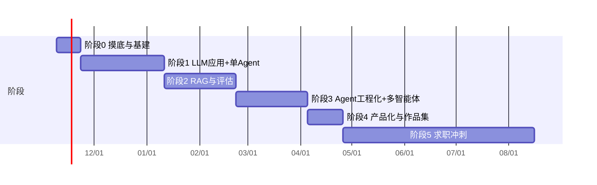

# AI Agent 工程师 · 转型学习总计划

> 制定日期：2026-11-09 ｜ 目标：2027 年内拿到 AI Agent / LLM 应用工程师 offer
> 起点：全栈工程师（偏前端）｜ 学习方式：在职，每周 10–14h

---

## 0. 一页纸结论

**路线**：不要走"AI 算法岗"，走 **AI 应用 / Agent 工程师**（也叫 LLM 应用开发、Agent 平台研发）。
理由：算法岗要求论文/训练经验，转岗成本极高；应用岗的核心能力是**工程 + 产品 + 模型理解**，正好卡在你的全栈底子上，而且 2025–2027 年这类岗位缺口最大、对"能落地"的人最饥渴。

**你的差异化**：市场上会调 API 的人很多，会写 Prompt 的人很多，**能把 Agent 做成一个用户敢用的产品的人很少**。前端全栈背景 = 流式交互、Agent 过程可视化、人工审批（HITL）、多模态输入、产品直觉，这是纯后端/纯算法背景的人补不动的短板。

**总时长**：24 周核心学习（2026-11-09 → 2027-04-25，约 300h）→ 16 周求职冲刺（2027-04 → 2027-08）。
**关键节点**：3 月中试水投递 → 4 月底正式开投 → 目标 7 月底前拿 offer。

**技术栈约定（2026-11-09 定，别反复改）**：
- 主语言 **TypeScript / Node**（你主要会 JS，Node 不熟就用手上这 5 个项目练到熟）；Python 只在读开源代码时用，不写生产代码。
- 默认 provider **DeepSeek**；千问 / MiniMax / OpenAI 作降级与对比（你四个 key 都有）。
- 所有项目从 `projects/_template` 复制，先跑通再改，**不要从零起**。

**取舍（很重要）**：
- 学：Agent 工程化、RAG 全链路、评测闭环、上下文工程、MCP、可观测、成本控制、系统设计。
- 不深入：模型预训练、分布式训练、CUDA 算子、论文复现。**会用、能讲清边界即可**。
- 不做：刷 LeetCode 300 题。保持每周 3 题维持手感就够。

---

## 1. 目标岗位画像

| 维度 | 内容 |
|---|---|
| 岗位名称 | AI Agent 工程师 / LLM 应用工程师 / AI 应用开发 / Agent 平台研发 / RAG 工程师 |
| 公司类型 | AI 原生创业公司（最缺人、面试最硬）、大厂 AI 应用部门、传统公司 AI 中台、SaaS 产品公司加 AI 功能 |
| 你的定位 | 3–6 年经验的"AI 应用全栈"，主打**能独立从 0 到 1 交付一个 Agent 产品** |
| 不投的岗 | 纯算法（要求顶会/训练）、纯 Infra（要求 GPU 集群）、纯标注/数据 |

**面试官筛人的三个问题**（所有准备都围绕它）：
1. 你**独立**做过什么 Agent 项目？上线了吗？有多少人用？
2. 出了效果问题（答不准、跑飞、太贵、太慢）你**怎么定位、怎么量化、怎么修**？
3. 你懂不懂模型的**边界**——什么时候该换模型、该上 RAG、该微调、该加规则，而不是无脑堆 Prompt？

### 1.1 市场现实（2026-11 调研，完整数据见 `research/job-market-2027.md`）

- **简历通胀严重**：候选人"十个有八个写精通 Agent"，但能讲清落地链路、评估方法、异常处理的人不到一成。→ 你的目标不是"会 Agent"，而是"**有一条被追问三层还不塌的链路**"。
- **评测（Evals）是 2026 年唯一硬通货**：4 场公开一面 4/4 都问"测试集哪来的、准确率怎么算"，甚至追问"20 个样本 95% 准确率的置信区间只有 76%–99%"。没有评测集的项目，故事讲不下去。
- **能力评价重心在迁移**：Prompt 调参（2023）→ 上下文工程（2025）→ **Harness 工程**（2026：系统级约束、工具边界、验证回路）。纯 Prompt 岗位薪资已被压到 10 万级。
- **MCP 从加分项变成硬性筛选**；A2A 写进多 Agent 岗职责；框架考的是"编排范式理解"，不是 API 记忆。
- **薪资锚点**（一线 3–5 年社招）：挂牌月薪主区间 **¥30k–50k，年包 45–75 万**；多 Agent 编排 / 长链路调度 / 行业知识库适配溢价 77%–122%；**端到端落地经验 > 学历**。
- **能力分级**：L0 API 接入 → L1 Prompt 操作员 → L2 RAG+工具应用 → **L3 Agent 系统工程师（面试起点）→ L4 产品化负责人**。多数前端转岗停在 L1–L2，卡点是"可靠性 + 评测"，不是模型知识。

> 对计划的三条直接影响：①评测集要**提前到 W9** 就开始建，不能等 W12；②每个项目都要有"失败模式分布"数据；③面试讲法一律用"做了什么 → 为什么这么做（代价）→ 踩过什么坑"三层结构。

---

## 2. 能力雷达与自评

按 0–4 分自评（0 没接触 / 1 看过没做过 / 2 跟教程做过 / 3 独立做过能讲透 / 4 能设计并带人做）。
先自评一次，把分数填进 `notes/自评.md`，在**W6 / W12 / W18 / W24** 各复评一次——**这是你判断"能不能投简历"的唯一客观标准**。

| # | 能力维度 | 面试权重 | 你的起点（估计） | 24 周目标 |
|---|---|---|---|---|
| 1 | LLM 原理与 API 工程（token/采样/结构化输出/多模型/流式） | ★★★★ | 1 | 3 |
| 2 | 上下文与 Prompt 工程（含上下文压缩、缓存、失败模式） | ★★★★ | 1 | 3 |
| 3 | RAG 与知识工程（解析/切分/检索/重排/评估） | ★★★★★ | 0 | 3 |
| 4 | Agent 架构与工具生态（ReAct/状态机/工具设计/MCP/多智能体） | ★★★★★ | 0 | 3 |
| 5 | 工程化（评测/可观测/成本/延迟/安全/部署） | ★★★★★ | 1 | 3 |
| 6 | 产品化与全栈交付（流式 UI/HITL/多模态/体验） | ★★★ | 3 | 4 |
| 7 | 系统设计与表达（白板画架构、讲清 trade-off） | ★★★★ | 2 | 3 |

> 注意第 3、4、5 项是**权重最高、你起点最低**的三项——它们决定你能不能过面试，所以时间分配向它们倾斜。
> 第 6 项是你唯一的 4 分项，必须做成作品集里的"记忆点"，不要只当背景。

**对照市场分级**（调研结论）：L2 = 你 24 周后的下限（RAG + 工具应用）；**L3 = 面试起点**（能设计系统、能评测、能讲清失败与兜底）；L4 = 产品化负责人（有真实用户、能定指标）。M5 里程碑判定标准就是 **L3 达成**。

---

## 3. 总体路线图

| 阶段 | 周次 | 时间 | 核心命题 | 交付物 |
|---|---|---|---|---|
| 0 | W1–W2 | 11-09 → 11-22 | 环境、基线、方向校准 | 多模型网关 Demo + 简历初稿 |
| 1 | W3–W9 | 11-23 → 01-10 | LLM 应用基本功 + 单 Agent 工具调用 | P1 工具型 Agent（含流式前端） |
| 2 | W10–W15 | 01-11 → 02-21 | RAG 全链路 + 评测闭环 | P2 知识库 Agent + 评测集 + 技术博客 |
| 3 | W16–W21 | 02-22 → 04-04 | Agent 工程化 + 多智能体 + 平台化 | P3 可视化 Agent 平台（开源） |
| 4 | W22–W24 | 04-05 → 04-25 | 垂直场景产品 + 作品集包装 | P4 上线产品 + 作品集站点 |
| 5 | W25–W40 | 04-26 → 08-08 | 面试冲刺与投递 | offer |

---

## 4. 每周节奏（固定下来，别改）

| 时段 | 时长 | 干什么 |
|---|---|---|
| 周二晚 | 1.5h | 读官方文档 / 论文 / 源码（**只读一手资料**） |
| 周三晚 | 1h | 同上，或整理笔记 |
| 周四晚 | 1.5h | 写代码（项目主线） |
| 周六 | 3h | 写代码（项目主线，整块时间） |
| 周日 | 3h | 写代码 + 跑评测 + 调试 |
| 周日晚 | 1h | **复盘**：写周记、更新自评、记录卡点、刷 2 道面试题 |
| 碎片时间 | ~1h | 通勤听播客 / 看技术推文，只做输入不做产出 |

**合计 ≈ 12h/周，24 周 ≈ 290h。**

**三条铁律**：
1. **产出优先**：每周必须有能跑的东西或能发的东西，不允许"这周在学理论"。
2. **一手资料优先**：官方文档 > 官方 cookbook > 高质量博客 > 视频课。视频只看"演示类"，不看"讲解类"（慢且二手）。
3. **写下来才算学会**：每个阶段至少 1 篇技术博客。写不出 = 没学会，面试也讲不出。

---

## 5. 阶段详解

### 阶段 0（W1–W2）：摸底与基建

**目标**：把"能跑通"的地基打好，避免后面在环境上浪费 30 小时。

**学**
- 主流模型 API 差异：OpenAI / Anthropic / DeepSeek / 通义 Qwen / GLM / Kimi（重点：定价、上下文长度、是否支持原生 tool calling、结构化输出、prompt caching）
- 结构化输出与 Function Calling 的机制差异（JSON mode vs schema-constrained）
- 流式输出（SSE）原理与前端消费方式

**做（P0：多模型网关）**
- 一个统一入口，对接 2–3 家模型，支持流式、失败自动切换、token 计费统计
- 一个极简 Web 界面：对话 + 模型切换 + 显示 token/耗时/费用
- 技术栈：Node/TypeScript（你熟）+ 一个 Python 小服务做对照

**交付物**：`projects/p0-llm-gateway` 可运行 + 一次真实比价测试（同一问题跑 3 个模型，记录成本/延迟/质量）

**验收标准**
- [ ] 断网/超时/429 时能自动降级到备用模型，前端不报错
- [ ] 能说清 3 家模型在同一任务上的成本与质量差异（用你自己的数据）
- [ ] 简历初稿写完（`plan/03-求职冲刺.md` 有模板）

**面试可讲点**：多模型路由、降级策略、流式协议、成本对比实测。

---

### 阶段 1（W3–W9）：LLM 应用基本功 + 单 Agent

**目标**：从"会调 API"跨到"会设计 Agent 循环"。

**学**
- Prompt / 上下文工程：few-shot、CoT、结构化输出、上下文压缩、prompt caching、长上下文失效现象
- Agent 循环：ReAct、Plan-and-Execute、Reflection；工具调用协议
- 工具设计原则：原子性、幂等、schema 描述、错误信息要"给人看也给模型看"
- 记忆：短期（对话）/长期（向量 + 结构化）/流程记忆
- 单 Agent 的失败模式：死循环、工具参数幻觉、上下文爆炸、错误累积

**做（P1：工具型 Agent）**
- 一个能"读文件 / 搜索 / 执行代码（沙箱）/ 调 HTTP 接口"的 Agent
- 前端：**Agent 过程可视化**（思考→工具调用→结果→结论的时间线），支持中途打断和人工确认
- 加保护：max steps、token 预算、超时、循环检测

**交付物**：`projects/p1-tool-agent` + 一篇博客《我如何给 Agent 加刹车》

**验收标准**
- [ ] 复杂任务（如"把这个仓库的依赖升级到最新并跑通测试"）能完成 ≥70%
- [ ] 人为注入失败（工具报错/返回垃圾）时能自我恢复，不崩、不死循环
- [ ] 前端能实时看到每一步工具调用与耗时
- [ ] 说得清"为什么这里不该用多智能体"

**面试可讲点**：Agent 循环设计、工具 schema 设计、断点恢复、成本与步数控制、流式与工具调用的冲突处理。

---

### 阶段 2（W10–W15）：RAG 全链路与评测闭环

**目标**：这是面试**最高频**的方向，必须做到"能自己造一套评估体系"。

**学**
- 文档解析（PDF/表格/图片 OCR）、切分策略（固定/语义/父子块/句子窗口）
- Embedding 选型与多语言（bge-m3、gte、voyage、OpenAI text-embedding-3）
- 向量库：pgvector / Qdrant / Milvus / LanceDB 的取舍
- 混合检索（BM25 + dense）、RRF 融合、rerank（bge-reranker / Cohere）
- 查询改写：多查询、HyDE、子问题拆解
- 评估：命中率 / MRR / nDCG / 忠实度 / 相关性；Ragas；LLM-as-judge 的偏差与校准
- 进阶：Agentic RAG、GraphRAG（知道何时用、何时是过度设计）

**做（P2：知识库 Agent）**
- 上传 50+ 篇真实文档（建议用你自己领域的技术文档），支持问答 + 引用溯源
- 建 **≥100 条评测集**（问题 + 标准答案 + 证据片段），做成可一键回归的脚本
- 对比 3 种切分 × 2 种检索策略，用数据说明最优组合
- 前端：引用高亮、原文定位、"没找到依据时拒答"

**交付物**：`projects/p2-rag-agent` + `eval/` 评测集 + 一篇带数据的博客《我把 RAG 命中率从 61% 提到 88% 的全过程》

**验收标准**
- [ ] 评测脚本一条命令跑完，输出指标对比表
- [ ] 能说清每次提升来自哪个改动（消融实验）
- [ ] 无依据时能拒答，不说幻觉
- [ ] 能讲出至少 5 种 RAG 失败模式及其对应修法

**面试可讲点**：切分策略 trade-off、混合检索、rerank 收益、评测集怎么建、LLM-as-judge 怎么防偏、拒答策略。**这一阶段的博客是简历上最值钱的东西。**

---

### 阶段 3（W16–W21）：Agent 工程化与多智能体

**目标**：从"能跑的 Demo"升级到"能上生产、能被人用的系统"。这一层是 2026 年后岗位要求的分水岭。

**学**
- 编排框架：LangGraph（状态机/检查点/中断恢复/时间旅行）、OpenAI Agents SDK、Claude Agent SDK、Vercel AI SDK、Mastra；**选一个深挖，其余知道边界**
- MCP：协议模型（tools / resources / prompts）、传输（stdio / SSE / streamable HTTP）、鉴权、Server 开发
- 多智能体：supervisor / handoff / swarm；**什么时候不要用多智能体**
- 可观测：Langfuse / LangSmith / OpenTelemetry GenAI 语义约定；trace 树、span、成本归因
- 评测工程：离线回归门禁、线上采样评估、A/B
- 安全：提示注入、工具越权、数据外泄、沙箱隔离、输出审核
- 部署与成本：容器化、队列、限流、多租户隔离、token 预算与模型分级路由

**做（P3：可视化 Agent 平台）**
- 支持可视化编排（节点式或配置式）、运行 trace 查看、成本看板、人工审批中断
- 实现一个 MCP Server（如"公司内部知识/工单"），并让 Agent 调用
- 接入 1 家可观测平台，trace 能追到每一次工具调用
- 加防注入：工具白名单、参数校验、敏感操作二次确认

**交付物**：`projects/p3-agent-platform` + 开源 + README 带架构图 + 一篇《Agent 上生产前必须补的 8 个洞》

**验收标准**
- [ ] 能画出完整架构图并讲清每一层的失败模式与兜底
- [ ] 任意一次运行可在 30 秒内查到：耗时花在哪、token 花在哪、哪一步失败
- [ ] 有 1 个真实外部用户试用并给出反馈
- [ ] 能讲清"为什么多智能体经常不如单智能体 + 好工具"

**面试可讲点**：编排框架选型、状态与检查点、MCP 设计与鉴权、可观测体系、成本优化、注入防护。**这是系统设计题的素材库。**

---

### 阶段 4（W22–W24）：垂直场景产品 + 作品集

**目标**：把"技术项目"变成"我的产品"。面试官只记得住产品，记不住仓库。

**做（P4：一个真正有人用的垂直 Agent）**
选一个你**有领域知识**的场景，做窄做深，2–3 周内上线：
- 候选方向：技术文档问答、招聘简历筛选、电商客服工单、个人知识管理、代码库巡检、前端页面自动化测试
- 必须：真实域名上线 + 至少 10 个真实用户 + 收集反馈 + 迭代一版

**同时做**
- 作品集站点（你的前端强项，别浪费）
- 简历终稿、GitHub Profile README、3 篇博客归档
- 系统设计白板训练：每周 1 道题，手写架构图 + 5 分钟讲解录音

**验收标准**
- [ ] 有 URL 能打开、有用户、有数据
- [ ] 简历上 3 个项目每个都能用 STAR 讲 3 分钟
- [ ] 能对任意一个项目画出"请求链路 + 失败兜底"图

---

### 阶段 5（W25–W40）：求职冲刺

详见 `plan/03-求职冲刺.md`。这里只给节奏：

| 时间 | 动作 |
|---|---|
| W25（4 月底） | 简历终稿、作品集上线、开始投递 30–50 家 |
| W25–W28 | 面试密度拉满，每场面后 24h 内复盘写进 `notes/面试复盘.md` |
| W29–W34 | 根据面试反馈补短板（大概率是系统设计 / 评测 / 分布式） |
| W35–W40 | 谈 offer、比价、决策、入职准备 |

**面试期学习原则**：面试驱动的学习 > 计划驱动的学习。被问倒什么就补什么，当天补完当天写进题库。

---

## 6. 项目阶梯（概览）

| 项目 | 周次 | 工时 | 核心技术 | 在简历上的角色 |
|---|---|---|---|---|
| P0 多模型网关 | W1–W2 | 12h | 流式、降级、成本统计 | 打底，不单独写 |
| P1 工具型 Agent | W3–W9 | 45h | ReAct、工具设计、HITL、过程可视化 | 主项目 1 |
| P2 知识库 Agent | W10–W15 | 50h | 混合检索、rerank、评测闭环 | 主项目 2（最值钱） |
| P3 Agent 平台 | W16–W21 | 60h | 编排、MCP、可观测、安全 | 主项目 3（拉开差距） |
| P4 垂直产品 | W22–W24 | 45h | 全栈交付、真实用户 | 记忆点 |

详细规格见 `plan/02-项目规格.md`。

---

## 7. 风险与砍单策略

| 风险 | 概率 | 应对 |
|---|---|---|
| 工作忙，每周投入不足 8h | 高 | 砍 P4，P3 降级为"只做可观测 + 一个 MCP Server"；总时长顺延 1 个月 |
| 陷入"教程地狱"，只看不做 | 高 | 每周日复盘时检查：本周有没有 commit？没有就下周停掉所有输入 |
| 项目烂尾 | 中 | 每个项目先写 README（含验收标准）再写代码；做不完就缩小范围，不推迟交付 |
| 面试被系统设计打穿 | 中 | W16 起每周 1 道白板题，录音自评；找 1 个同伴互面 |
| 只学不做产品，简历没记忆点 | 中 | P4 不可砍，只能缩小场景 |
| 市场变化（岗位要求升级） | 低 | 每 4 周读 10 份在招 JD，更新 `research/job-market-2027.md` |

**如果只有 12 周**（加速版）：砍掉 P3 与 P4，做 P1 + P2 + 一个"能演示"的垂直 Demo；每周投入提到 20h；3 月底开始投。

---

## 8. 视频 / 题库接入机制

你说会给视频链接（含面试真题和实际开发问题）。**已完成（2026-11-09）**：视频是抖音《Minimax Agent面试分享》（可瑞吉crazy，366s），抖音原链抓不到（原因见 `research/douyin-7694618490191453352-transcript.md` §3），改用 B 站同款 `av117410900214125` 取音频 + faster-whisper 转写。

处理结果：
1. **全量转写** → `research/douyin-7694618490191453352-transcript.md`（含原始 ASR 留档 + 按三轮重写的正文 + 转写踩坑记录）。
2. **抽题入库** → `plan/05-高频题库.md` §4：**T001–T031 共 31 题**（一面 10 / 二面 13 / CTO 面 8），带时间点、考点、价值、挂载周。
3. **回填计划** → 已按真实周次挂载（W2/W3/W4/W5/W9/W11/W12/W16/W19/W23/W24），并对计划补了 5 处（见 `plan/05` §4.2）。
4. **每周抽考**：每周日晚随机抽 3 题自测，答不出的标红，下周复考（§5 红黄绿追踪表）。

以后你还有新视频/新题，直接发链接，我按同样流程增量入 T032 起编号。

---

## 9. 下一步（这周就做的 3 件事）

1. **读框架**：`plan/06-框架总纲.md`（15 分钟）+ `kb/01-全景图.md`（七层架构），把七层和 K01–K13 考纲混个脸熟。
2. **补素材**：把 [`notes/我的素材.md`](../notes/我的素材.md) 里 6 个 `❓待补` 填掉——你现职业务的数字是简历里最值钱的部分，也是面试最容易被问穿的地方。
3. **排时间**：把每周 12h 写进日历（周一二三晚 + 周六日），这是唯一能保证执行的动作。

> **第 0 步（今天就能做，30 分钟）**：读 [`kb/01-全景图.md`](../kb/01-全景图.md) 把七层记住，
> 然后 `cd projects/_template; node src/main.ts` 看一遍真实链路，再 `node src/eval/run.ts --k 3` 看一遍评测。
> 这两条命令跑通，你对"Agent 工程师每天在做什么"就有了具体图像，比读十篇文章有用。
> 你的 4 个 key 都现成（默认用 DeepSeek），所以 W1 不需要等任何账号。

---

## 附：文档索引

| 文件 | 用途 |
|---|---|
| `plan/06-框架总纲.md` | ★ **地图**：五根支柱 + 七层要点 + 13 个模块考纲（配 `plan/框架总纲.html` 可视版） |
| `plan/00-总计划.md` | 本文，路线与阶段 |
| `plan/01-周计划.md` | 24 周逐周任务表（执行用） |
| `plan/02-项目规格.md` | 5 个项目详细规格与验收 |
| `plan/03-求职冲刺.md` | 简历、投递、面试、谈薪 |
| `plan/04-资源清单.md` | 文档/课程/论文/工具 |
| `plan/05-高频题库.md` | 面试题库（持续增长，含视频内容） |
| `kb/00-索引.md` | 知识库入口（按问题/按层/按周三向查） |
| `kb/01-全景图.md` | ★ 七层架构，全库骨架，先读这个 |
| `kb/02-概念/` | 13 篇核心概念（每篇 6 段固定结构） |
| `kb/03-框架/` | 选型决策树 / 排障四轴 / 项目骨架 / 设计文档模板 |
| `kb/04-术语表.md`、`kb/05-常见误解.md` | 查词、考前扫误解 |
| `projects/_template/` | ★ 零依赖 Agent 骨架（可直接 `node` 跑），所有项目的起点 |
| `projects/` | 代码（P0–P4） |
| `research/job-market-2027.md` | 岗位调研 |
| `research/interview-bank.md` | 面试题与实战坑调研 |
| `notes/` | 自评、周记、复盘、面试记录 |
| `scripts/check-links.mjs` | 改完文档后跑一次，检查死链 |
