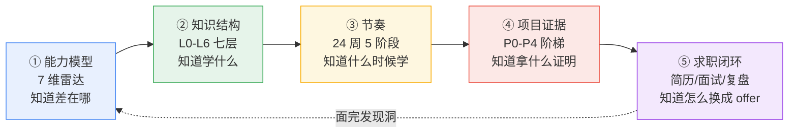

# AI Agent 工程师 · 学习框架总纲

> 一句话：**这份文档是"地图"，不是"课本"** —— 告诉你学什么、按什么顺序学、每个点要学到什么程度、学完用什么证明。
> 细节分散在 `kb/`（理解）、`plan/01`（节奏）、`projects/`（证据），这里只做**结构化总纲**。
> 制定：2026-11-09 ｜ 目标：2027 年内拿到 Agent / LLM 应用工程师 offer

---

## 0. 三种用法

| 场景 | 用法 | 花多久 |
|---|---|---|
| 想看全貌 | 只读第 1 节五根支柱 + 第 7 节要点大纲目录 | 5 分钟 |
| 开工前定位 | 读第 3 节「七层要点」，找到自己卡在哪一层 | 15 分钟 |
| 每周复盘 | 用第 9 节清单逐条打勾，红了就进周记 | 10 分钟 |

**读法建议**：先看第 2 节的图，再看第 7 节的要点清单（那是"考纲"），最后按第 4 节的节奏执行。

---

## 1. 学习框架：五根支柱

学 AI 应用最容易犯的错是"学了一堆名词但没有一条链路能讲透三层"。所以框架不是知识清单，而是**五个互相咬合的部件**：



**为什么是这五根**：

- 只有①没有② → 知道要补 RAG，但不知道 RAG 里到底缺哪一环（解析？召回？重排？）
- 只有②没有③ → 陷入"什么都想学"，24 周变 48 周
- 只有③没有④ → 学完讲不出一个能落地的项目，简历还是空的
- 只有④没有⑤ → 项目做得再好，面试问三层就崩
- ⑤ 回指 ① → 每次都面完才真正知道自己缺什么，所以**面试要早开始（3 月中试水）**

---

## 2. 支柱①：能力模型（7 维雷达）

0–4 分自评：0 没接触 / 1 看过没做过 / 2 跟教程做过 / 3 独立做过能讲透 / 4 能设计并带人做。

| # | 维度 | 面试权重 | 起点 | 24 周目标 | 最强的一句话判据 |
|---|---|---|---|---|---|
| 1 | LLM 原理与 API 工程 | ★★★★ | 1 | 3 | 能算 token 成本、能解释为什么 temp=0 也不可复现 |
| 2 | 上下文与 Prompt 工程 | ★★★★ | 1 | 3 | 能说出上下文窗口里每一段的预算和丢弃顺序 |
| 3 | RAG 与知识工程 | ★★★★★ | 0 | 3 | 能画出"召回率是天花板"的链路并指出本项目的天花板在哪 |
| 4 | Agent 架构与工具生态 | ★★★★★ | 0 | 3 | 能解释为什么这个场景不该用多 Agent |
| 5 | 工程化（评测/观测/成本/安全） | ★★★★★ | 1 | 3 | 能拿出评测集 + 失败分布 + 成本曲线 |
| 6 | 产品化与全栈交付 | ★★★ | 3 | 4 | 能做出用户看得懂、敢点的流式 + 可中断界面 |
| 7 | 系统设计与表达 | ★★★★ | 2 | 3 | 白板 15 分钟画完七层并说清 trade-off |

> 第 3、4、5 项 = **权重最高 + 起点最低**，时间必须向它们倾斜。第 6 项是你唯一的优势项，要变成作品集的记忆点。
> 自评表在 [notes/自评.md](../notes/自评.md)，复评节点 **W6 / W12 / W18 / W24**。

**段位判据（市场口径）**：L2 = 24 周下限（RAG + 工具应用）；**L3 = 面试起点**（能设计、能评测、能讲失败与兜底）；L4 = 产品化负责人（有真实用户能定指标）。

---

## 3. 支柱②：知识结构（七层）

**为什么按层而不按技术栈**：面试问的永远是"这段为什么放这层"。按层学，你答的是设计；按框架学，你答的是 API。

| 层 | 职责 | 关键点（详见第 7 节） | 典型故障 |
|---|---|---|---|
| **L6 体验层** | 流式渲染、中断、审批、错误态 | 幂等键必须从这里传下去 | 用户重复点击 → 重复下单 |
| **L5 编排层** | 循环、工具选择、预算、多 Agent | 步数/成本/墙钟三重预算前置检查 | 死循环烧钱 |
| **L4 上下文层** | 提示分层、压缩、记忆、检索拼接 | 缓存友好前缀、压缩腐化 | 长上下文中间信息丢失 |
| **L3 模型层** | 采样、结构化输出、FC 协议、降级 | 严格 JSON 只保语法不保语义 | 解析崩、成本爆 |
| **L2 工具层** | schema、校验、错误分类、幂等、MCP | 工具失败要返回结果而不是抛异常 | 参数幻觉、重试风暴 |
| **L1 数据层** | 解析、切分、embedding、检索、重排 | 权限过滤必须下推到检索侧 | 越权 / 滤空 |
| **L0 横切** | 评测、trace、成本、安全 | 评测判定器本身也会写错 | 假绿、线上不可复现 |

> 层间接口的三条铁律（面试高频）：
> 1. **L6→L5 必须传幂等键**，不能让模型自己编。
> 2. **L5→L2 的参数一律当不可信输入**，必须校验。
> 3. **L4→L1 的权限过滤必须下推到检索**，后过滤会把结果滤空。

全景图 + 读代码定位法见 [kb/01-全景图.md](../kb/01-全景图.md)。

---

## 4. 支柱③：节奏（24 周 5 阶段）

| 阶段 | 周次 | 时间 | 核心命题 | 交付物 |
|---|---|---|---|---|
| 阶段 0 摸底与基建 | W1–W2 | 11-09 → 11-22 | 跑通骨架、摸清后端闭环 | P0 多模型网关 |
| 阶段 1 LLM 应用 + 单 Agent | W3–W9 | 11-23 → 01-10 | 工具调用、结构化输出、失败恢复 | P1 工具型 Agent + 30 条评测 |
| 阶段 2 RAG 与评估 | W10–W15 | 01-11 → 02-21 | 检索全链路 + 评测闭环 | P2 知识库 Agent + 回归 |
| 阶段 3 工程化 + 多智能体 | W16–W21 | 02-22 → 04-04 | 沙箱、MCP、可观测、多 Agent | P3 可视化平台（开源） |
| 阶段 4 产品化与作品集 | W22–W24 | 04-05 → 04-25 | 真实用户、指标、技术写作 | P4 垂直产品 |
| 阶段 5 求职冲刺 | W25–W40 | 04-26 → 08 | 投递、面试、复盘迭代 | offer |

**每周固定节奏**（约 12h）：周一/二/三晚各 2h（学）+ 周六 4h（写）+ 周日 2h（复盘 + 自测）。

**里程碑**：M1 11-22（能讲七层）→ M2 01-10（单 Agent + 评测）→ M3 02-21（RAG 闭环）→ M4 04-04（平台 + 开源）→ M5 04-25（**L3 达成，可投简历**）→ M6 08-08（offer）。

**降载周**：W8 元旦、W14 春节（2027 春节 2/6）只保持手感，不追进度。逐周任务见 [plan/01-周计划.md](01-周计划.md)。

---

## 5. 支柱④：项目证据（P0–P4 阶梯）

| 项目 | 周次 | 工时 | 一句话 | 简历价值 |
|---|---|---|---|---|
| P0 多模型网关 | W1–W2 | 12h | 统一入口 + 流式 + 降级 + 计量 | 证明工程底子，不是玩具 |
| P1 工具型 Agent | W3–W9 | 45h | 工具 + 评测集 + 错误恢复 | 主力项目，讲三层追问 |
| P2 知识库 Agent | W10–W15 | 50h | RAG 全链路 + 权限 + 评测回归 | 最贴岗位 JD |
| P3 可视化 Agent 平台 | W16–W21 | 60h | 编排 + 观测 + 沙箱 + 开源 | 差异化，前端优势主场 |
| P4 垂直产品 | W22–W24 | 45h | 真实用户 + 指标 + 写作 | 证明能落地 |

**每个项目必须有的四件套**：场景（谁的问题）→ 职责（我做了什么）→ **关键决策与权衡（为什么不用另一个方案）** → 可验证结果（指标 + 数字 + 置信区间）。

**每个项目必须踩 1 个坑**（从题库 P1–P16 里选），并在 README 写"怎么发现的、怎么修的、修完指标变化"。这是面试官最容易被击中的地方。

规格见 [plan/02-项目规格.md](02-项目规格.md)，状态见 [projects/README.md](../projects/README.md)。

---

## 6. 支柱⑤：求职闭环

| 环节 | 要点 | 文档 |
|---|---|---|
| 简历 | 定位 → 代表作（3 项目 × 四件套）→ 工作经历 → 开源/博客 → 技能靠后 | [plan/03](03-求职冲刺.md) |
| 投递 | 3 月中试水 5–8 家 → 4 月底主攻 30–50 家 → 7–8 月补漏 | 同上 |
| 面试 | 4 轮（基础/项目深挖/系统设计/HR）各有打法 | 同上 + [plan/05](05-高频题库.md) |
| 复盘 | 每场面完 24h 内写：问到了什么、我答崩在哪、补哪篇笔记 | [notes/面试复盘.md](../notes/面试复盘.md) |

**转岗动机 90 秒话术**（必须背下来）：前端全栈 → 做 Agent 是"从画界面到做决策"，优势是能把不可靠的模型能力包装成用户敢用的产品。

---

## 7. 要点大纲（考纲：13 个知识模块 + 工程清单）

> 每条都是"**必须能讲清**"的判据，不是"看过"。打勾标准：能用自己的项目举例说 3 分钟不塌。
> 每条的展开（定义/机制/边界代价/工程落点/追问）在 `kb/02-概念/` 对应文件。

### K01 LLM 基础与成本
- [ ] 一次请求的 token 是怎么算的，成本公式能口算（输入价 ≠ 输出价）
- [ ] 采样参数（temperature/top_p/stop/max_tokens）各自影响什么，什么时候调
- [ ] 为什么 `temperature=0` 也不能保证完全可复现（浮点非结合性、batch 组合、MoE 路由、并发）
- [ ] KV cache 占用估算 ≈ `2 × batch × layers × hidden × seq × 字节`，GQA 按 KV 头数缩
- [ ] 长上下文为什么不能替代检索（lost-in-middle / context rot）
- [ ] 什么时候换小模型、什么时候上微调、什么时候加规则

### K02 上下文工程
- [ ] 系统提示、工具说明、历史、检索内容、用户输入在窗口里的**预算分配**与丢弃顺序
- [ ] 前缀稳定的好处（prompt caching），什么改动会让缓存全失效
- [ ] 压缩/摘要的三种触发时机与"压缩腐化"（越压越丢关键约束）
- [ ] working notes / 结构化记忆 比无脑堆历史省 40%–60% token
- [ ] 多轮里"用户改了主意"怎么处理（覆盖而非追加）

### K03 结构化输出与工具调用
- [ ] Function calling 协议：请求/响应/tool_call_id 怎么串
- [ ] 严格 JSON 模式只保语法、不保语义（字段对但业务错）
- [ ] 参数幻觉的三种表现与校验层兜底（schema + 业务校验 + 回填重试）
- [ ] 流式 + 工具调用冲突（参数被当成正文流出去）
- [ ] 解析失败的降级链：严格模式 → 宽松解析 → 修复提示 → 人审

### K04 工具设计与 MCP
- [ ] 工具 schema 怎么写才不容易被误调用（名字/描述/枚举/必填）
- [ ] 工具失败为什么应返回 `ok:false` 而不是抛异常
- [ ] 幂等键为什么必须由调用方传、不能让模型生成
- [ ] 写操作三件套：确认、幂等、超时≠未发生（重试前先查状态）
- [ ] MCP = JSON-RPC 2.0 + host/client/server，tools/resources/prompts，stdio vs Streamable HTTP
- [ ] MCP 安全：OAuth 2.1、token 绑 audience、禁 token passthrough、防 tool poisoning / rug pull
- [ ] MCP 与 Function Calling 是叠加关系不是替代

### K05 Agent 架构
- [ ] 单 Agent 循环的最小状态机（模型 → 工具 → 观察 → 再模型）
- [ ] 死循环检测：动作签名（同参数同工具）而不是只看步数
- [ ] 什么时候该用工作流（DAG）而不是 Agent（自由循环）
- [ ] 单 Agent 工具数经验值 2–5，超过 10 明显不稳（选错/参数错）
- [ ] 多 Agent 失败主因是协调而非个体能力；MAST 从 1600+ trace 归纳出 14 类失效模式（系统设计 / 跨 agent 失配 / 验证）
- [ ] 多 Agent 只买上下文隔离（≈15× token 换并行窗口），2–3 个 specialist 是甜点
- [ ] 架构该停在哪层：S1 单循环 → S2 路由/规划/记忆 → S3 显式状态机 → S4 多智能体（见 `kb/03-框架/05-架构演进.md`）
- [ ] handoff 为什么会失真（交接摘要丢约束），怎么传结构化上下文

### K06 记忆
- [ ] 短期（窗口）/ 长期（外部存储）/ 情节（episodic）三种记忆的边界
- [ ] 写入策略：什么时候写、写什么、谁负责淘汰
- [ ] 记忆污染的危害与"可删除、可溯源"设计
- [ ] 用户偏好 vs 事实知识要分库存（一个用检索，一个用注入）

### K07 RAG 全链路
- [ ] 解析（PDF/表格/图片）、切分（语义/结构/重叠）、元数据（来源/权限/版本）
- [ ] 召回是天花板：先量 recall@k，再谈 rerank 和 prompt
- [ ] 混合检索（BM25 救精确词、向量救语义）+ 重排（救排序）
- [ ] 权限过滤必须下推到索引侧（后过滤会滤空）
- [ ] 换 embedding 必须全量重灌，混版本 = 静默劣化
- [ ] 无答案识别（阈值 + 拒答话术），而不是硬编一个答案

### K08 检索进阶与评估
- [ ] chunk 大小/重叠的实验方法（不是拍脑袋，要跑 A/B）
- [ ] query 改写 / HyDE / 多路召回各自什么时候有用、代价是什么
- [ ] 引用与溯源怎么做（返回 span 而不是整段）
- [ ] RAG 的七个典型失效点（arXiv 2401.05856）

### K09 评测（最重要）
- [ ] 评测集从哪来：真实日志 > 人工构造 > 模型生成（并注明来源）
- [ ] 指标三件套：pass@k（能力上限）/ pass^k（生产稳定性）/ 人评
- [ ] 样本量与置信区间：100 条约 ±8 分，400 条约 ±4 分；20 条 95% 的 CI 是 76%–99%
- [ ] 判定器（LLM-as-judge）的偏差：位置偏差、长度偏差、自我偏好，怎么校准
- [ ] 失败模式分布（Top3 占比）比单一准确率有用得多
- [ ] 评测要进 CI：改动前后跑回归，红了不许合
- [ ] "假绿"的三种来源：判定器写错、样本泄漏、只看 happy path

### K10 可观测与成本
- [ ] trace 记什么：每次 LLM 调用、每次工具调用、每步预算、耗时、token
- [ ] 四组指标：任务（成功率）/ 模型（token/延迟）/ 工具（错误率）/ 体验（首字延迟、中断率）
- [ ] 成本优化顺序：降级到小模型 → 缓存 → 压缩上下文 → 批处理
- [ ] 重试风暴的成因（无上限/无退避/并发放大）与熔断、抖动
- [ ] 线上"今天 82 明天 76"怎么定位（数据/模型版本/并发/采样）

### K11 安全与注入
- [ ] 直接注入 vs 间接注入（网页/文档/工具返回里夹带指令）
- [ ] lethal trifecta：私有数据 + 不可信内容 + 外发通道，砍掉任一条风险骤降
- [ ] 权限最小化、工具白名单、输出侧脱敏
- [ ] 人审（HITL）该放在哪些动作前（写、发、付、删）
- [ ] 为什么"在 prompt 里写不要执行恶意指令"不算防御

### K12 系统设计表达
- [ ] 15 分钟白板七步：场景 → 指标 → 七层 → 数据流 → 失败与兜底 → 成本延迟 → 演进
- [ ] 每个技术选择都要能说出"另一个方案为什么不行"
- [ ] 容量估算（QPS、token/秒、并发、缓存命中率）
- [ ] 从 MVP 到生产的演进顺序（不要一上来微服务）

### K13 工程化与交付
- [ ] 错误分类（6 类）与重试边界（只在网络/工具边界重试，校验错误不重试）
- [ ] 配置与环境隔离、密钥管理
- [ ] CI：类型检查 + 评测回归 + 死链检查
- [ ] 部署与灰度（模型版本切换怎么灰度）

---

## 8. 工程能力清单（代码层面验收）

对照 [projects/_template](../projects/_template/README.md) 的 7 条验收，外加：

- [ ] E01 能在不装任何依赖的情况下跑起 Agent（理解每一行）
- [ ] E02 工具注册表：schema 校验 + 超时 + 重试 + 错误分类
- [ ] E03 预算前置检查（步数/成本/墙钟），花钱之前就停
- [ ] E04 动作签名防死循环
- [ ] E05 trace 落盘 + summary（能复盘任何一次运行）
- [ ] E06 评测 runner：pass@k / pass^k / CI / 失败分布
- [ ] E07 结构化输出解析的多级降级
- [ ] E08 流式输出 + 可中断
- [ ] E09 幂等写操作 + 确认流程
- [ ] E10 MCP server 能跑起来并被 host 调用
- [ ] E11 权限过滤在检索侧
- [ ] E12 成本/延迟面板（哪怕是最简版）

---

## 9. 面试要点大纲

**核心结构：每一题都要能答三层** —— ① 怎么衡量 → ② 为什么不用另一个方案 → ③ 线上坏了怎么定位。只答第一层 = 背答案。

| 类别 | 题号 | 挂载周 |
|---|---|---|
| LLM 基础与成本 | Q1–Q4 | W5 |
| 上下文工程 | Q9–Q12 | W6 |
| 结构化输出与注入 | Q13–Q15 | W7 |
| Agent 基础 | Q16–Q18 | W9 |
| 工具与记忆 | Q19–Q21 | W11 |
| 失败恢复 | Q22–Q24 | W13 |
| RAG 全链路 | Q25–Q28 | W15 |
| 检索进阶 | Q29–Q31 | W17 |
| 评测 | Q32–Q35 | W19 |
| 工程化 | Q36–Q39 | W21 |
| 安全 | Q40–Q42 | W22 |
| 系统设计 | Q43–Q46 | W23 |

**16 个真实生产坑**（P1–P16）必须在项目里踩过至少 1 个，详见 [plan/05-高频题库.md](05-高频题库.md) 第 3 节映射表。

**每周日 15 分钟自测**：随机抽 3 题 → 每题目述 3 层 → 记 🟢/🟡/🔴 → 连续两次 🟢 才算掌握。

---

## 10. 自检清单（每周日 + 每个里程碑）

**每周日（10 分钟）**
- [ ] 本周产出物提交了吗（代码/笔记/评测结果）
- [ ] 本周新学的东西，能用自己的项目举一个例子吗
- [ ] 抽 3 道题自测，🟡 以上的题记进下周
- [ ] 雷达哪一维动了？没动就是没学到

**每个里程碑（M1–M5）**
- [ ] 能不能 15 分钟白板画完七层并讲清 trade-off
- [ ] 有没有一条"被追问三层还不塌"的链路
- [ ] 评测集有多少条、失败分布是什么、CI 有没有 ± 区间
- [ ] 这段经历的简历四件套能写出来吗

---

## 11. 这套框架和其他文档的关系

```
plan/06-框架总纲.md   ← 你现在看的：地图（学什么 / 到什么程度）
    ├─ plan/00-总计划.md      为什么这么定（市场依据、取舍）
    ├─ plan/01-周计划.md      什么时候学（W1–W24 逐周）
    ├─ plan/02-项目规格.md    用什么证明（P0–P4）
    ├─ plan/03-求职冲刺.md    怎么换成 offer
    ├─ plan/05-高频题库.md    考纲题目版（46 题 + 16 坑）
    ├─ kb/01-全景图.md        结构版（七层 + 层间接口）
    ├─ kb/02-概念/*.md        展开版（13 篇，每篇 6 段）
    ├─ kb/03-框架/*.md        方法论（选型/排障/骨架/设计文档）
    └─ projects/_template/    可运行的参考实现
```
